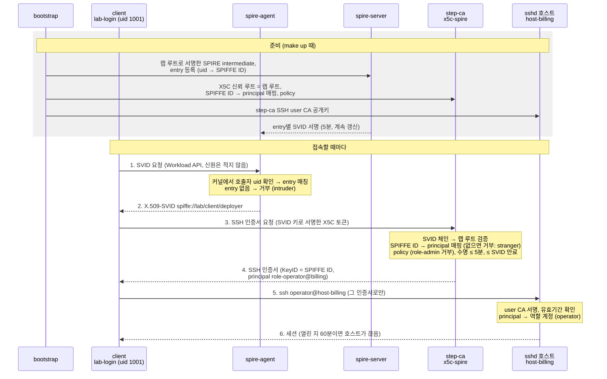

# lampson-lab

워크로드 신원으로 역할 기반 SSH 접근을 하는 랩입니다. 정적 키 대신 단기 인증서를 씁니다. (SPIRE + step-ca 참조 구현)

> 이름은 Butler Lampson에게서 따왔습니다. 그의 "speaks for" 모델이 이 랩이 구현하는 체인을 설명합니다: 워크로드 → 신원 → 역할 → 계정.

## 동작 구조



준비 단계는 `make up`이 한 번 합니다. 신뢰 관계를 심는 단계입니다. 그 뒤로 접속할 때마다 아래 순서를 밟습니다 (`lab-login`이 1~5를 한 번에 합니다).

1. client의 계정이 spire-agent에 SVID를 요청합니다. 요청에는 신원을 적는 곳이 없습니다.
2. agent는 커널에서 호출한 프로세스의 uid를 확인하고, 등록된 entry와 맞으면 그 SVID를 줍니다. entry가 없는 uid(intruder)는 여기서 거부됩니다.
3. client가 SVID 키로 서명한 X5C 토큰으로 step-ca에 SSH 인증서를 요청합니다.
4. step-ca가 SVID 체인을 랩 루트로 검증합니다. 이어서 SPIFFE ID를 매핑해 principal을 정하고, policy와 수명 상한을 적용해 서명합니다. 매핑이 없는 신원(stranger)과 `role-admin@*`은 여기서 거부됩니다.
5. 그 인증서로만 호스트에 접속합니다. 호스트는 step-ca의 SSH user CA만 믿고, principal로 어느 역할 계정에 들어갈 수 있는지 정합니다.
6. 세션이 열립니다. 인증서가 만료돼도 열린 세션은 유지되지만, 연결이 열린 지 60분이 지나면 호스트가 끊습니다.

## Quick Start

필요한 것: Docker (Compose v2 이상), `make`. 테스트까지 돌리려면 [사용법](#사용법)의 목록을 보세요.

```
$ git clone https://github.com/gnu-gnu/lampson-lab.git && cd lampson-lab
$ make up          # 빌드, 기동, bootstrap까지. 끝나면 "lab is up"
```

헬퍼(`lab-login`) 없이 기본 도구(`spire-agent`, `step`, `ssh`)로 위 그림의 단계를 하나씩 밟아 봅니다. 터미널을 두 개 엽니다. 하나는 client 안(deployer)이고, 다른 하나는 저장소 디렉터리에서 호스트 로그를 보는 용도입니다.

```
$ docker compose exec -u deployer client bash
deployer$ cd "$(mktemp -d)"
```

**1. SVID 받기 (그림의 1~2).** agent가 이 프로세스의 uid를 보고 SVID를 줍니다. 요청에는 신원을 적는 곳이 없습니다.

```
deployer$ spire-agent api fetch x509 -socketPath "$SPIRE_AGENT_SOCKET" -write .
deployer$ step certificate inspect --short svid.0.pem
  Subject:     spiffe://lab/client/deployer
  Valid from:  ...T14:44:05Z
          to:  ...T14:49:15Z            # 5분짜리, 절반쯤 지나면 agent가 새로 받음
```

**2. 단기 SSH 인증서 서명 요청 (그림의 3~4).** SVID 키로 서명한 X5C 토큰을 보내면, step-ca가 SVID를 검증하고 SSH 인증서를 서명합니다. `--not-after`로 수명을 정합니다(최대 5분, 그리고 SVID 만료 전까지).

```
deployer$ x5c=(--provisioner x5c-spire --x5c-cert svid.0.pem --x5c-key svid.0.key
               --ca-url "$STEP_CA_URL" --root "$STEP_CA_ROOT" --no-password --insecure --no-agent)
deployer$ step ssh certificate spiffe://lab/client/deployer id_ecdsa \
            --principal role-operator@billing --not-after 2m "${x5c[@]}"
deployer$ ssh-keygen -L -f id_ecdsa-cert.pub
        Key ID: "spiffe://lab/client/deployer"
        Serial: 16374253206351982465
        Valid: from ...T14:44:25 to ...T14:46:25
        Principals:
                role-operator@billing
```

거부되는 요청도 해 볼 수 있습니다. 모두 rc 1이고 인증서 파일이 만들어지지 않습니다.

| 요청 | step-ca 응답 |
|---|---|
| `--principal role-admin@billing` | `role-admin@billing is never issued` |
| `spiffe://lab/client/monitor` (다른 계정의 key id) | `key id "spiffe://lab/client/monitor" is not the SVID's SPIFFE ID ...` |
| `--not-after 10m` | 거부. SVID가 그보다 먼저 만료되면 `provisioning credential expiration ... is before requested certificate validBefore`가 나오고, 그렇지 않으면 5분 상한 위반으로 거부됩니다 (AC-09) |
| stranger 계정으로 1·2단계 | SVID는 받지만 `spiffe://lab/client/stranger has no SSH mapping` |
| intruder 계정으로 1단계 | `PermissionDenied desc = no identity issued` (SVID 자체가 없음) |

**3. 그 인증서로 접속 (그림의 5~6).** 다른 키나 agent를 쓰지 않도록 지정합니다.

```
deployer$ o=(-i id_ecdsa -o CertificateFile=id_ecdsa-cert.pub -o IdentitiesOnly=yes -o IdentityAgent=none
             -o StrictHostKeyChecking=accept-new)
deployer$ ssh "${o[@]}" operator@host-billing 'id; hostname'
uid=1001(operator) gid=1001(lab-operator) groups=1001(lab-operator)
host-billing
deployer$ ssh "${o[@]}" admin@host-billing true     # Permission denied (principal 불일치)
deployer$ ssh "${o[@]}" operator@host-crm true      # Permission denied (crm principal 없음)
```

호스트 쪽 터미널에서는 같은 serial을 확인합니다.

```
$ docker compose logs --no-log-prefix host-billing | grep -E 'Accepted publickey|authorized principal|expired'
Accepted publickey for operator ... ID spiffe://lab/client/deployer (serial 16374253206351982465) ...
Certificate does not contain an authorized principal      # admin@ 시도
```

`Valid ... to` 시각이 지난 뒤 같은 `ssh` 명령을 다시 실행하면 `Permission denied`가 나오고, 호스트 로그에 `Certificate invalid: expired`가 남습니다 (AC-19). 1분짜리(`--not-after 1m`)로 받으면 금방 확인할 수 있습니다. 반대로 만료 전에 열어 둔 세션은 계속 유지됩니다 ([인증서 만료와 열린 세션](#인증서-만료와-열린-세션-ac-20)). 끝나면 `rm -rf "$PWD"; exit`으로 임시 디렉터리(SVID 키, SSH 키)를 지우고 나옵니다. 지우지 않아도 client 컨테이너와 함께 `make down` 때 사라집니다.

헬퍼로 한 번에 하려면 `lab-login role-operator@billing operator@host-billing`입니다 ([사용법](#사용법)). 랩을 지우려면 `make down`을 실행합니다. 컨테이너, 볼륨, 생성된 키가 모두 사라집니다.

## 무엇을 보여 주는가

1. **신원은 프로세스에서 나옵니다.** client 컨테이너의 계정(uid)마다 SPIRE가 X.509-SVID를 줍니다. 등록되지 않은 계정(intruder)은 아무것도 받지 못합니다.
2. **SSH 인증서는 신원으로만 받습니다.** step-ca는 SVID로 서명된 요청(X5C)만 받고, principal은 클라이언트가 고르지 않습니다. SPIFFE ID를 매핑해서 step-ca가 정합니다.
3. **호스트에는 개인 계정이 없습니다.** `admin` / `operator` / `readonly` 역할 계정만 있고, 인증서의 principal `role-<role>@<group>`이 어느 호스트 그룹의 어느 역할인지 정합니다.
4. **모든 것이 짧게 삽니다.** SSH 인증서는 최대 5분이고, 근거가 된 SVID보다 오래 가지 못합니다.
5. **모든 동작은 자동 테스트로 판정합니다.** 실패해야 하는 경우는 실패한 이유(로그에 남은 거부 사유)까지 확인합니다.

| client 계정 | SPIFFE ID | 받는 principal | 접속 가능 |
|---|---|---|---|
| deployer (1001) | `spiffe://lab/client/deployer` | `role-operator@billing` | `operator@host-billing` |
| monitor (1002) | `spiffe://lab/client/monitor` | `role-readonly@billing`, `role-readonly@crm` | `readonly@host-billing`, `readonly@host-crm` |
| stranger (1003) | `spiffe://lab/client/stranger` | 없음 (발급 거부) | 없음 |
| intruder (1004) | 없음 (SVID 거부) | 없음 | 없음 |
| (누구도) | | `role-admin@*`는 발급되지 않음 | `admin@*`에는 아무도 접속할 수 없음 |

## 사용법

필요한 것: Docker (Compose v2 이상), `make`, `jq`, `git`, `python3`, `openssl`, `ssh-keygen` (마지막 셋은 AC-22 테스트가 호스트에서 씁니다). AC-22는 gitleaks 이미지를 처음 실행할 때 받습니다. linux/arm64에서 검증했습니다. 사용하는 이미지와 바이너리는 linux/amd64용도 제공되지만, amd64에서는 실행해 보지 않았습니다.

| 명령 | 동작 |
|---|---|
| `make up` | 빌드, 기동, bootstrap 완료까지 대기. 수동 단계 없음 |
| `make test` | 전체 수용 테스트(AC-01 ~ AC-22, EP-11). 하나라도 실패하면 exit ≠ 0. 약 9분 (AC-21이 `make down && make up && make test`를 두 번 돌림, arm64 실측) |
| `make test-fast` | 기다리는 테스트(AC-19, AC-20, AC-21) 제외. 약 30초 |
| `make down` | 컨테이너, 볼륨, 생성된 키를 모두 제거 (compose 프로젝트 `lampson-lab` 라벨이 붙은 볼륨은 지금 compose 파일에 없는 것까지 제거) |
| `make shell-client` | client 컨테이너 root 셸. root에는 SPIRE entry가 없어 SVID를 받지 못하므로 `lab-login`은 아래처럼 계정을 지정해 씁니다 |

client 안에서 직접 해 볼 수 있습니다. client에는 capability가 없어 `su`로 계정을 바꿀 수 없으므로, 계정을 지정해 들어갑니다.

```
$ docker compose exec -u deployer client bash
deployer$ lab-ssh-cert role-operator@billing        # 인증서만 받기 (경로 출력)
deployer$ ssh-keygen -L -f ~/.lab-ssh/id_ecdsa-cert.pub
deployer$ lab-login role-operator@billing operator@host-billing
deployer$ lab-login role-operator@billing operator@host-billing sudo -n /usr/local/bin/demo-restart
deployer$ lab-login role-operator@billing admin@host-billing          # Permission denied
$ docker compose logs host-billing | grep Accepted                    # KeyID(SPIFFE ID)와 serial
```

`lab-login <principal> <user@host> [command]`은 현재 uid로 SVID를 받고, `x5c-spire`에서 SSH 인증서를 받은 뒤, 그 인증서만으로 접속합니다 (다른 키와 agent는 쓰지 않음).

`docker compose up`만 단독으로 실행하지 말고 `make up`을 쓰세요. `make up`은 bootstrap의 PKI 단계를 먼저 실행한 뒤 나머지를 띄웁니다. `docker compose up`만 하면 bootstrap이 PKI를 만드는 것과 spire-server가 upstream 인증서를 찾는 것이 경쟁해서, 결과가 실행마다 달라집니다.

## 인증서 만료와 열린 세션 (AC-20)

**SSH 인증서가 만료돼도, 그 전에 열린 세션은 끊기지 않습니다.** 이 랩의 AC-20 테스트는 이 동작을 확인하는 문서화 테스트입니다. 1분짜리 인증서로 세션을 연 뒤, 만료 후 1분이 지나도 세션이 계속 출력하고 정상 종료(rc 0)하는지 봅니다. 같은 시점에 같은 인증서로 새로 접속하면 거부됩니다 (AC-19, sshd 로그 `Certificate invalid: expired`).

이유: OpenSSH의 sshd는 인증서의 유효기간을 **인증할 때 한 번만** 확인합니다. 인증이 끝난 세션에는 인증서가 더 관여하지 않고, sshd에는 "인증서가 만료되면 세션을 끊는" 기능이 없습니다. KRL(인증서 폐기 목록)도 새 인증만 막습니다.

그래서 단기 인증서가 제한하는 것은 **새로 인증할 수 있는 기간**, 즉 새 SSH 연결을 맺을 수 있는 기간이지, 그 연결로 할 수 있는 일의 기간이 아닙니다.

- 인증서가 유효할 때 맺은 연결은 스스로 끝날 때까지 유지됩니다.
- 그 연결 위에서는 만료 뒤에도 **새 세션을 더 열 수 있습니다.** 예를 들어 OpenSSH 다중화(`ControlMaster`)로 연결을 열어 두면, 인증서가 만료된 뒤에도 그 연결로 새 명령을 실행할 수 있습니다. 1분짜리 인증서로 확인했을 때 만료 11초 뒤에도 새 세션이 열렸고, 같은 시각에 새로 연결하는 것은 거부됐습니다.

### 연결 최대 60분 (EP-11)

그래서 호스트는 연결 길이에 별도의 상한을 둡니다. **모든 SSH 연결은 열린 지 60분이 지나면 호스트가 끊습니다**(`SESSION_MAX_SECONDS: 3600`, docker-compose.yml). 인증서 수명(5분)과는 독립된 값이고, 모든 계정에 같습니다. AC-20은 그대로 성립합니다. 세션은 인증서가 만료된 뒤에도 60분까지는 유지됩니다.

- **누가 끊나:** billing·crm 호스트마다 `lab-session-reaper`(sshd/session-reaper.sh)가 root로 돕니다. 5초마다 연결별 sshd 프로세스(`sshd-session: <user> [priv]`)의 나이를 보고, 상한을 넘은 연결을 끊습니다. 그래서 실제로는 60분에서 최대 5초 늦게 끊깁니다.
- **무엇이 끊기나:** 연결 전체입니다. 그 위의 다중화(`ControlMaster`) 세션과, 세션이 실행한 명령도 함께 끝납니다. 다만 세션 안에서 PID 1 밑으로 떨어져 나간 프로세스(데몬처럼 분리된 것)는 찾지 못합니다.
- **기록:** 끊을 때 호스트 로그에 `lab-session-reaper: closed connection: user=<계정> pid=<n> user-child=<m> ... age=<초>s`를 남깁니다. sshd 로그의 `User child is on pid <m>` 바로 앞의 `Accepted publickey ... (serial <n>)` 줄이 그 연결의 인증서입니다.
- **sshd 설정만으로 안 되는 이유:** `ChannelTimeout`, `UnusedConnectionTimeout`은 **유휴** 연결만 정리하므로 쓰고 있는 연결은 끊지 않습니다.
- **감시가 멈추면:** 호스트 healthcheck가 실패합니다(unhealthy).

작업 예정시간을 승인받고 그 시간만큼만 연결을 허용하는 흐름은 구현하지 않았습니다. step-ca webhook과 별도 승인 시스템(JIT 승인)이 필요해서 이 랩의 범위 밖에 둡니다.

## 알아 둘 동작

- **SSH 인증서 수명:** 모든 인증서는 최대 5분입니다. monitor는 15분까지 받을 수 있게 하려 했지만, step-ca 0.30.2에서는 길이 상한을 계정마다 다르게 줄 수 없어 가장 작은 상한(deployer 5분)을 함께 씁니다. 인증서는 근거가 된 SVID보다 오래 갈 수 없어서, 받는 시점의 SVID 남은 수명에 따라 이보다 짧을 수 있습니다. 이보다 긴 요청은 줄여서 발급하지 않고 거부합니다 (AC-09).
- **agent 재시작:** client는 spire-agent와 PID 네임스페이스를 공유하므로, agent가 멈추거나 다시 시작되면 client도 함께 종료됩니다. 이때는 `make up`을 다시 실행하세요.
- **SVID 만료 복구:** 랩을 1시간(agent SVID 수명) 넘게 멈춰 둔 뒤에도 `make up`만으로 복구됩니다. bootstrap이 만료된 agent를 정리하고 새 join token을 발급합니다.
- **agent 볼륨 유실:** `spire-agent-data` 볼륨이 사라져도 `make up`만으로 복구됩니다.
- **설정 반영:** `make up`은 매번 step-ca 컨테이너를 다시 만들어, 저장소의 provisioner·템플릿·policy를 반영합니다.
- **entry 수동 변경:** SPIRE entry를 손으로 바꿨다면 `make up`을 다시 실행하세요. bootstrap이 `bootstrap/spire-entries.txt` 상태로 되돌립니다. entry를 지워도 agent는 수 초 동안 캐시된 SVID를 계속 내줍니다.
- **호스트 키:** 호스트 인증서는 쓰지 않으므로 client는 처음 접속할 때 호스트 키를 신뢰합니다(TOFU). 호스트 키는 `make down` 전까지 유지됩니다.

## 고정 버전

버전은 [`.env`](.env) 한 곳에서 관리합니다. `latest` 태그는 쓰지 않습니다.

| 구성 요소 | 버전 |
|---|---|
| SPIRE (server, agent) | 1.16.0 |
| step-ca | 0.30.2 |
| step CLI | 0.31.0 |
| Debian (bootstrap, client, sshd 호스트) | `trixie-20261104-slim` |
| gitleaks (AC-22 테스트) | 8.30.1 (태그와 digest 고정) |
| OpenSSH (sshd 호스트, apt) | 확인 시점 패키지 `1:10.0p1-7+deb13u4`, 배너 `OpenSSH_10.0p2` (고정 아님) |

## 구성

```
bootstrap (일회성, make up마다 실행, 멱등)
  ├─ 고정 랩 루트 ──서명──> SPIRE intermediate ──(UpstreamAuthority disk)──> spire-server CA
  ├─ join token  ──────────────────────────────> spire-agent
  ├─ workload entry (unix:uid, SVID TTL) ──────> spire-server
  └─ step-ca: TLS 루트(랩 루트와 별도), SSH user CA 키,
              ca.json (x5c-spire 하나, roots = 랩 루트, 템플릿, policy),
              SSH user CA 공개키 ──> step-ca-public 볼륨 ──> sshd 호스트, client

client (pid: service:spire-agent, capability 없음)
  deployer(1001) / monitor(1002) / stranger(1003) ──SVID 요청──> spire-agent ──> 발급
  intruder(1004)                                  ──SVID 요청──> spire-agent ──> 거부

  lab-ssh-cert: SVID로 X5C 토큰 서명 ──> step-ca (x5c-spire)
                                         1. 토큰: 체인이 랩 루트로 검증되는가, 재사용이 아닌가
                                         2. 템플릿: SVID의 SPIFFE ID → 매핑 → principal, SVID 수명 검사
                                         3. 유효기간: 인증서 끝 ≤ SVID NotAfter
                                         4. policy: principal allow/deny
                                         5. 길이 ≤ 5분 (provisioner 상한)
                                       ──> SSH 사용자 인증서 (KeyID = SPIFFE ID)

  lab-login: 위 인증서로만 ssh ──> host-billing (group billing) / host-crm (group crm)
                                   TrustedUserCAKeys = step-ca SSH user CA 하나
                                   AuthorizedKeysFile none
                                   /etc/ssh/auth_principals/<role> = role-<role>@<group>
                                   admin: sudo ALL / operator: sudo demo-restart만 / readonly: sudo 없음
                                   로그: Accepted ... ID <SPIFFE ID> (serial N)
```

- SVID 체인: SVID → SPIRE CA → 랩 intermediate → 랩 루트. step-ca의 X5C provisioner는 이 랩 루트 하나만 믿습니다.
- 신원 매핑은 위 계정 표와 같습니다. 구현은 `bootstrap/spire-entries.txt`, `step/ssh-mapping.json`, `step/templates/ssh-user.tpl`, `step/policy/ssh-user.json`입니다.
- `role-admin@*`은 템플릿과 policy가 각각 막습니다. AC-05는 무엇이든 서명하는 템플릿을 끼운 일회용 step-ca로 policy만으로도 막히는지 확인합니다.
- client 컨테이너는 capability가 하나도 없습니다. client의 root라도 uid를 바꾸거나 agent의 파일에 접근할 수 없습니다.
- step-ca는 X.509 인증서와 호스트 인증서를 발급하지 않습니다.

## 알려진 한계

| 한계 | 내용 |
|---|---|
| add-user 인증서 | step-ca 0.30.2는 요청하면 템플릿과 policy를 거치지 않는 두 번째 인증서(principal `provisioner`, KeyID가 SPIFFE ID가 아님)를 서명합니다. 끌 수 없습니다. 이 인증서로는 어느 호스트, 어느 계정에도 접속할 수 없음을 AC-12, AC-13이 확인합니다. 알려진 한계로 둡니다. |
| 로그의 토큰 | step-ca는 요청의 X5C 토큰을 로그에 남기고, SPIRE는 join token이 든 agent ID를 로그와 DB에 남깁니다. |
| 키 보호 | CA 키는 모두 암호화 없이 Docker 볼륨에 있습니다 (KMS/HSM은 비목표). |
| monitor 수명 | 15분까지 주려 했지만 5분으로 묶입니다 (step-ca 0.30.2는 계정별 길이 상한을 지원하지 않음). |
| 열린 연결 | 인증서가 만료돼도 열린 연결은 최대 60분 유지되고, 그동안 그 연결 위에서 새 세션도 열 수 있습니다. 세션에서 분리돼 PID 1 밑으로 간 프로세스는 연결을 끊어도 남습니다. |
| 빌드 재현성 | 이미지는 태그로, apt 패키지는 버전 없이 받습니다. |
| 테스트용 완화 | sshd의 `PerSourcePenalties`를 껐습니다. 거부 테스트가 client를 막지 않게 하기 위해서이며, 운영에서는 켜 둡니다. |

## 테스트

`tests/run.sh`(= `make test`)가 `tests/ac/*.sh`를 차례로 실행하고 항목마다 PASS/FAIL을 출력합니다. AC-xx는 수용 기준이고, EP-11은 그 뒤에 더한 항목(연결 최대 60분)입니다.

- 기대값은 구현 설정을 읽지 않고, 위 계정 표를 테스트 코드에 직접 옮겼습니다.
- 실패해야 하는 시나리오는 같은 실행에서 정상 경로가 성공하는지(양성 대조)와, 거부 이유를 함께 확인합니다. 거부 이유는 step-ca 로그의 메시지나 sshd 로그에서 그 인증서의 serial이 거부된 줄입니다.
- 테스트 파일이 중간에 끝나거나, 선언한 AC를 보고하지 않거나, `tests/expected-acs`의 AC를 아무도 보고하지 않으면 FAIL입니다.

| 파일 | AC |
|---|---|
| `01-svid-issued.sh`, `02-intruder-no-svid.sh` | SVID 발급과 거부 |
| `03` ~ `10` | 인증서 발급: principal, TTL, extension, 거부 경로, 위조, 토큰 재사용 |
| `11` ~ `18` | 접속, 권한, 감사 로그 |
| `19-expiry.sh` (slow) | AC-19 만료 후 재접속 실패, AC-20 열린 세션 유지 |
| `21-idempotency.sh` (slow) | AC-21 `make down && make up && make test` 2회 |
| `22-no-secrets.sh` | AC-22 커밋된 키·토큰 없음 (git 이력 전체를 gitleaks로, `.gitignore`) |
| `23-session-limit.sh` (slow) | EP-11 연결 최대 60분 (20초 상한의 임시 호스트로 확인) |
